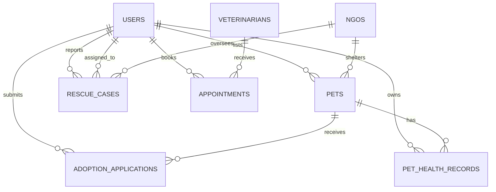

# Pet Connect — Database Schema & Data Models

Pet Connect is modeled with high-integrity document schemas compatible with MongoDB and flexible document stores.

---

## 1. Entity-Relationship Overview



---

## 2. Core Schemas

### User
```typescript
interface User {
  id: string;
  name: string;
  email: string;
  passwordHash: string; // bcrypt hash
  role: 'adopter' | 'owner' | 'volunteer' | 'ngo' | 'vet' | 'admin';
  phone?: string;
  city?: string;
  address?: string;
  avatar?: string;
  organizationName?: string;
  verified: boolean;
  createdAt: string;
}
```

### Pet
```typescript
interface Pet {
  id: string;
  name: string;
  species: 'Dog' | 'Cat' | 'Bird' | 'Rabbit' | 'Other';
  breed: string;
  ageYears: number;
  ageMonths: number;
  gender: 'Male' | 'Female';
  size: 'Small' | 'Medium' | 'Large';
  color: string;
  city: string;
  state: string;
  status: 'available' | 'pending' | 'adopted';
  description: string;
  images: string[];
  vaccinated: boolean;
  sterilized: boolean;
  specialNeeds: boolean;
  specialNeedsDescription?: string;
  personalityTraits: string[];
  energyLevel: 'Low' | 'Medium' | 'High';
  goodWithKids: boolean;
  goodWithOtherPets: boolean;
  shelterId?: string;
  ownerId?: string;
  createdAt: string;
}
```

### AdoptionApplication
```typescript
interface AdoptionApplication {
  id: string;
  petId: string;
  applicantId: string;
  applicantName: string;
  email: string;
  phone: string;
  city: string;
  address: string;
  occupation: string;
  age: number;
  homeType: 'Apartment' | 'Independent House' | 'Villa / Farmhouse';
  hasYard: boolean;
  isOwnerOrRenter: 'Owner' | 'Renter';
  hasPets: boolean;
  currentPetsDescription?: string;
  familyMembersCount: number;
  familyAgrees: boolean;
  dailyHoursAlone: number;
  adoptionReason: string;
  carePlan: string;
  status: 'pending' | 'under_review' | 'interview_required' | 'approved' | 'rejected' | 'completed';
  adminNotes?: string;
  createdAt: string;
}
```

### RescueCase
```typescript
interface RescueCase {
  id: string;
  animalType: 'Dog' | 'Cat' | 'Cow' | 'Bird' | 'Other';
  conditionSummary: string;
  description: string;
  emergencyLevel: 'Low' | 'Medium' | 'High' | 'Critical';
  locationAddress: string;
  latitude: number;
  longitude: number;
  reporterName: string;
  reporterPhone: string;
  reporterUserId?: string;
  status: 'reported' | 'assigned' | 'in_progress' | 'rescued' | 'treatment' | 'rehabilitating' | 'closed';
  assignedVolunteerId?: string;
  assignedNgoId?: string;
  photos: string[];
  triageNotes: string[];
  createdAt: string;
}
```

### LostAndFoundReport
```typescript
interface LostAndFoundReport {
  id: string;
  type: 'lost' | 'found';
  petName?: string;
  species: 'Dog' | 'Cat' | 'Bird' | 'Rabbit' | 'Other';
  breed?: string;
  gender?: 'Male' | 'Female' | 'Unknown';
  color: string;
  distinctiveMarks: string;
  lastSeenAddress: string;
  latitude: number;
  longitude: number;
  incidentDate: string;
  contactName: string;
  contactPhone: string;
  images: string[];
  status: 'active' | 'reunited' | 'claimed';
  createdAt: string;
}
```

### PetHealthRecord & Reminders
```typescript
interface PetHealthRecord {
  id: string;
  petId: string;
  vaccinations: Array<{
    name: string;
    dateAdministered: string;
    nextDueDate: string;
    administeredBy: string;
    batchNumber?: string;
  }>;
  medicalHistory: Array<{
    date: string;
    diagnosis: string;
    treatment: string;
    veterinarianName: string;
  }>;
  allergies: string[];
  currentMedicines: string[];
}

interface PetCareReminder {
  id: string;
  userId: string;
  petName: string;
  category: 'Vaccination' | 'Medication' | 'Grooming' | 'Vet Visit' | 'Deworming' | 'Feeding';
  title: string;
  dueDate: string;
  completed: boolean;
}
```
